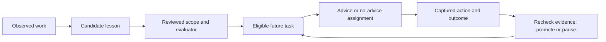

# Lyo — Learn Your Own

**A feedback layer that tests what an AI coding agent should carry into its next task.**

A saved lesson is a hypothesis. Lyo gives it a scope, an evaluator and a history:
when it was delivered, what happened afterward, and whether later evidence
justifies continuing to use it. It works through agent hooks and local SQLite,
with an implemented ordinary-session trial loop for **Codex and Claude Code**.

The goal is an agent workflow that improves from experience across repositories.
The current prototype implements collection, scoped delivery, prospective
comparisons, promotion and withdrawal. Its controlled demos exercise that loop;
useful transfer across independent coding tasks is the next validation milestone.

[Run the demo](#run-the-demo) · [Application brief](docs/hackathon-brief.md) ·
[Current status](docs/development-status.md) · [Documentation](docs/README.md)

## The problem

A note saying “run the tests” does not tell you whether the advice was relevant,
whether the agent followed it, or whether it improved the result. As tasks and
repositories change, yesterday's useful advice can also become misleading.

Lyo makes those distinctions explicit. **Could this evidence exist while the
claim is false?** That proxy-versus-witness question is a standing reasoning
mandate. The ledger checks the observable part: a delivered prompt is delivery
evidence; a passing check is a check result; useful advice needs later comparison.

## How it works



1. **Observe:** hooks retain local session and tool events, with optional sync
   into a personal central corpus.
2. **Prepare:** register a reviewed lesson, trigger and evaluator. This is an
   explicit setup step; telemetry alone does not invent a sound experiment.
3. **Deliver and compare:** matching ordinary sessions enter a prospective
   advice/no-advice trial. Both groups use the same declared outcome check.
4. **Revise:** a completed comparison can promote scoped delivery. A later failed
   or unknown outcome pauses it for review; corrected evidence can revoke promotion.

New turns and compactions also refresh the standing mandate and eligible lessons.
Scope and validity are rechecked before reinjection. Repetition earns no learning
credit, and withheld trial advice stays withheld.

The learned state is lesson validity and delivery policy in the ledger. Lyo does
not update model weights. [Workflow and evidence contracts](docs/scoped-session-findings.md)
explain what the checks establish and where evaluator judgment remains necessary.

## Run the demo

Requires **Node.js 24+**, npm and Git. These commands use a POSIX shell; no model
API key, agent installation or global hook configuration is needed.

```sh
git clone https://github.com/bebekim/learn-your-own.git
cd learn-your-own
npm ci
node evidence/finding-feedback-loop-2026-09-10/run.ts "$(mktemp -d)"
```

The demo executes a real parser against an explicit whitespace contract:

- The original lesson recommends `trim()`. A Unicode counterexample falsifies it.
- Lyo records the contradiction and suppresses that wording.
- A scripted revision targets the tested contract.
- A later application receives the revision, passes the contract, and retains support.

Expected result, alongside the temporary SQLite path:

```json
{
  "original": "contradicted",
  "revised": "supported",
  "validity": "supported",
  "incrementalBenefit": "unknown"
}
```

Inspect `report.json` and `journal.json` beside that SQLite file. The actions and
hook events are scripted; the parser execution and ledger transitions are real.
`unknown` is intentional: this demo verifies the feedback mechanism, not whether
an independently acting agent benefits from the prompt. The
[trial-policy tests](tests/finding-trial-policy.test.ts) separately exercise
comparison → promotion → later pause on controlled outcomes.

## What is working

| Capability | Current support |
|---|---|
| Native telemetry, workspace connection and central sync | Local SQLite; source identity retained |
| Ordinary-session experiments | Codex and Claude Code; reviewed trigger/evaluator required |
| Timely guidance | Turn/compaction refresh; current scope and finding validity checked |
| Evidence and correction | Versioned deliveries, paired action capture, registered checks, semantic review and withdrawal |
| Scoped policy updates | Fixed prospective comparison, promotion, later monitoring and pause |
| Other integrations | ECA/Emacs and IBM Bob have capture/delivery adapters; adaptive trial coverage differs |

Source baseline: **`0.4.3-adaptive.9`**. Validation: **689 tests passed, one skipped**,
plus typecheck and inward dependency checks. The evidence refactor preserves
receipt and workflow behavior. [Refactor validation](issues/refactor-evidence-domain.md)
and [earlier configured-hook checks](evidence/context-refresh-2026-09-11/README.md).

The retained transfer experiment did not establish a useful reusable coding
intervention: its verifier missed a Unicode edge case. That result helped shape
the current evidence boundaries. [Results and open work](docs/development-status.md)

## Use it in ordinary work

Start with the [installation and hook guide](docs/hook-installation.md), then
[register a prospective finding trial](docs/prospective-finding-trials.md).

**Use the source checkout for this prototype.** npm's `latest` tag was still
`0.2.0` when checked on 11 September 2026; a plain registry install does not provide
this workflow. To install the version built from this checkout:

```sh
npm run pack:local
npm install -g ./dist/lyo-kernel-0.4.3-adaptive.9.tgz
lyo --help
```

The hook guide distinguishes the repository ledger, central telemetry corpus and
lesson store. Local paths and launch services in historical rollout records are
examples from the development machine, not prerequisites for a new installation.

## Architecture and next milestone

The TypeScript kernel retains evidence and state transitions. Host adapters supply
observations; selection and trial policies decide delivery; registered evaluators
measure declared outcomes. SQLite keeps the feedback history inspectable locally.
The host retains control over tool execution and permissions.

The next milestone is **one demonstrably useful loop on independent real tasks**:
a reviewed lesson, appropriate delivery, positive later outcomes and a comparison
that justifies continued use. Broader applicability must be tested; counterexamples
should narrow or revise it. Learned representations, sequence credit, a general
explanation-graph compiler and a baduk/Go adapter remain longer-term work.

[Architecture and code map](docs/development-status.md#architecture-and-code-map) ·
[Spec completion map](Specs/README.md) · [Product requirements](issues/prd.md)

## Development

```sh
npm test
npm run typecheck
npm run pack:local
```

Feature work uses worktrees and squash merges, with tests and typecheck before
merge. See [AGENTS.md](AGENTS.md). RTK is part of the author's development setup;
it is not required to run Lyo or the demo.

Lyo is **source-available** under the [Lyo Source-Available License](LICENSE.md).
