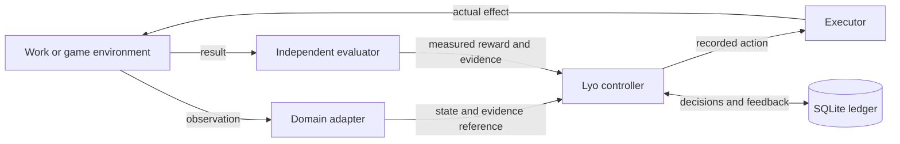

# Adaptive feedback loop: first implemented increment

Reference for the earlier native recovery experiment, which is separate from [ordinary finding trials](prospective-finding-trials.md). A passing retry does not establish ticket acceptance or useful learning.

Status: experimental; implemented on `main` in `v0.4.2`, 2026-09-09.

Local `0.4.3-adaptive.0` also distinguishes Kimi Code CLI events received through
`claude-hook`. Kimi telemetry retains its host identity and does not enter the
native Claude experiment. A populated telemetry corpus is not evidence that
eligible Codex or Claude checks have reached the adaptive controller.
See the [development status](development-status.md) for the broader roadmap,
evidence limits, and rollout state.

Lyo can now record a decision, receive a measured consequence, and change a
later decision from that evidence. The records survive process restarts.
This implements a small adaptive controller alongside the existing telemetry
and lesson systems. It does not make their accumulated observations into
validated intervention outcomes.

The [literature survey](../papers/2026-09-09-cybernetic-learning-survey.md)
motivates this direction. The implementation below is deliberately limited to
one decision per episode and small discrete states.

## Where the feedback closes



The controller owns the selection and evidence history. The domain adapter
defines what can be observed, what actions mean, and the objective. The executor
actually performs the selected action. The evaluator determines the result.
Lyo checks their identities and record consistency; it does not authenticate
the contents of an evidence file or independently verify an arbitrary reward.

For the implemented calibration:

| Role | Concrete implementation |
| --- | --- |
| Observation | A JavaScript program uses `require` or `import` syntax. |
| Action | Execute Node with `--input-type=commonjs` or `--input-type=module`. |
| Objective | Correct output under a two-second process timeout. |
| Evaluator | Exit status and an exact expected-output check in the experiment runner. |
| Feedback | Reward 1 for success, 0 for failure; retained stdout, stderr, and timing. |
| Adaptation | Update the measured mean return for that state and action. |

For this binary objective, an error can be written as `1 - reward`. The
controller estimates which action has the smaller expected error. It does not
generate an explanation in prose or train the underlying language model.

## What is learned, and what is supplied

`FeedbackController` implements `tabular-mean@1`. During `explore`, it selects
uniformly from the declared actions and records the selection probability.
For each exact observed state and action, it computes:

```text
estimated return = sum of measured exploration rewards / number of measurements
```

During `evaluate`, it chooses the action with the largest estimated return.
Every action must have a measurement in that state first; otherwise it uses the
declared baseline. A tie also favors the baseline. Missing measurements have
`mean: null`, not an invented zero.

The state fields and available actions are supplied by the experiment designer.
Their values are learned from outcomes. There is no hand-written rule saying
which syntax gets which action. One sample per action is only a coverage
condition, not a confidence threshold or permission to deploy a policy.

This is the tabular, one-step form of a contextual decision problem. It cannot
learn a useful representation of arbitrary code or a Go board, nor assign
credit among a sequence of edits or moves. Those are separate, unimplemented
problems. We first need evidence that decisions and consequences meet reliably.

## Why another repository can benefit

Repository paths are evidence references, not required selection keys. A new
repository that produces the same state under the same versioned specification
uses the same action estimates. JSON property order does not change the state.

An unseen state uses the baseline. This first increment does not infer that two
different states are similar. It provides transfer between matching observations,
not evidence of generalization to new task families.

The specification includes `domain`, `objective`, `evaluator`, `stateSchema`,
`actions`, and `baselineAction`. Changing any of these creates a separate
controller identity. Change their versions when their meanings change, including
the model or executor version when it changes the treatment. In the calibration,
the evaluator identity includes Node's version and the runner's source hash.
Coding and Go can share this protocol while retaining separate evidence.

## Workflow through the public CLI

These are feature-checkout commands; use Node 24+. They return JSON. The API is
also exported as `FeedbackController` from `lyo-kernel`.

1. Write a fixed `spec.json` describing the experiment:

   ```json
   {
     "domain": "coding/verification-experiment",
     "objective": "verified-completion-within-budget@1",
     "evaluator": "frozen-task-check@1",
     "stateSchema": "verification-context@1",
     "actions": ["continue", "verify"],
     "baselineAction": "continue"
   }
   ```

2. At the decision point, save the observation and write `request.json`:

   ```json
   {
     "episodeId": "ticket-123-attempt-1",
     "state": {"verification": "missing", "language": "javascript"},
     "observationRef": "ticket-123/state.json",
     "mode": "explore"
   }
   ```

   ```sh
   rtk proxy node src/cli.ts control decide --db /absolute/shared/control.sqlite --spec spec.json --input request.json
   ```

3. The adapter executes the returned action within the experiment's defined
   budget. After the evaluator runs, write `feedback.json` using the returned
   decision ID and actual action:

   ```json
   {
     "decisionId": "<returned decision.id>",
     "executedAction": "<returned decision.action>",
     "evaluator": "frozen-task-check@1",
     "reward": 1,
     "evidenceRef": "ticket-123/result.json"
   }
   ```

   ```sh
   rtk proxy node src/cli.ts control feedback --db /absolute/shared/control.sqlite --spec spec.json --input feedback.json
   rtk proxy node src/cli.ts control inspect --db /absolute/shared/control.sqlite --spec spec.json --episode-id ticket-123-attempt-1
   ```

The illustrative `continue`/`verify` executor and evaluator above are not
implemented. The executable end-to-end adapter in this increment is the
JavaScript calibration below. Reward must come from the declared measurement,
not from an agent deciding its own advice was helpful.

Separate processes can use these commands against the same explicit `--db`.
That closes the persistence gap across sessions. The existing corpus collector
does **not** import the new `control_decisions` and `control_feedback` tables.
Codex and Claude now write these records directly into the configured central
corpus when `adaptiveFeedback` is enabled. ECA/MLX and Bob are not connected to
this controller in this increment.

The native adapter calls `decide` after a failed check, before the agent's next
recovery action, and `feedback` at the turn boundary. Opening a repository can initialize
the connection, but is usually too early to observe the particular decision's
state. A session-start lesson banner alone cannot supply this control loop.

## Retries, delays, and evaluation

An episode ID identifies one decision under one specification. Retrying the
same request returns the stored choice without resampling. A conflicting
request is rejected. Identical feedback is counted once; a conflicting finalized
measurement is rejected. An unknown (`reward: null`) receipt can be followed by
a measured result, with both retained for inspection. There is no correction or
retraction operation for finalized measurements in this increment.

Each decision records a policy revision: a cutoff in measured exploration
feedback. Set `mode: "evaluate"` and an explicit `revision` to keep the policy
fixed while comparing new attempts. Revision zero uses the baseline. Later
training can update the current policy without altering a frozen one.
Evaluation outcomes are retained but never train this controller.
An explicit revision is a central-ledger cutoff, so the same revision can
freeze Codex and Claude even when their latest measurements have different
sequence numbers. Each controller still uses only its own matching evidence.

The experiment runner owns the training/test split. The general CLI cannot
detect a caller relabeling the same task as a new episode. Independent task
assignment and a trustworthy evaluator remain responsibilities of the adapter.

## TDD increments completed

| Behavior | Failure observed before implementation | Result |
| --- | --- | --- |
| Persist feedback and change a later decision | Public controller did not exist. | SQLite survives reopen; measured values change selection. |
| Retry safely | Repeated decision resampled. | Stored decisions and duplicate feedback are idempotent. |
| Validate feedback | A different evaluator was accepted. | Invalid identity, action, reward, and evidence references are rejected. |
| Freeze evaluation | Requested revision was ignored. | Later training cannot alter a pinned policy. |
| Validate the experiment | Invalid action spaces were accepted. | Invalid specifications and observations are rejected. |
| Execute a real calibration | `eval control` was unknown. | Real child-process results train and evaluate the controller. |
| Accept delayed evidence | A measured result conflicted with an earlier unknown. | Both receipts are retained; only the measurement trains. |
| Connect separate processes | `control decide` was unknown. | CLI decision, feedback, and inspection share the episode. |

A further regression check confirms matching observations transfer, while
different states, domains, and evaluator versions remain separate.

## Run and inspect the calibration

```sh
rtk proxy node src/cli.ts eval control --dir .agent-learning/experiments/new-calibration --seed 42
```

The output directory must be new. The runner saves its registration before
execution, then 32 randomized training episodes and 12 paired test cases.
Every test case runs the fixed baseline and the frozen learned policy. It
preserves the inputs, observation and result files, decision records, SQLite
ledger, hashes, and report. Timeouts count as failures; other process-launch
errors abort the experiment.

The retained [run and assessment](../evidence/adaptive-feedback-2026-09-09/assessment.md)
show 6/12 baseline successes and 12/12 learned successes. This is a calibration
with known answers, not a coding-agent benchmark. Two syntax states, one seed,
and new numeric inputs do not establish generalization or real-ticket benefit.

## Native Codex and Claude connection

Add the following field to the existing central workspace configuration,
`~/.lyo/config.json` (or the file selected by `LYO_CONFIG_FILE`):

```json
"adaptiveFeedback": { "mode": "explore" }
```

The complete configuration still needs its existing absolute `rootDir` and
`corpusPath`. Omitting `adaptiveFeedback` disables the adapter. Only workspaces
under `rootDir` participate. Both hosts write into `corpusPath` directly;
their controller identities remain separate because their measurements differ.

The first failed, recognised test/build/lint command in a turn creates one
episode. The controller selects `no-guidance` or `recovery-reminder` with equal
probability. The latter emits a short diagnostic and recheck reminder through
`hookSpecificOutput.additionalContext`. The action being tested is **emitting
the reminder**, not a claim that the agent obeyed it.

At `Stop`, reward is 1 if the last qualifying retry of the exact same command
and working directory passed, or 0 if no such recovery was observed. A pending,
background, interrupted, or unrecognised result is unknown. An episode that
reaches `SessionEnd` or a new prompt without `Stop` is also unknown. A retry must
have started after the intervention; an already-running parallel check cannot
earn recovery credit. Duplicate callbacks retain one decision and one outcome.

This is a proximal check-recovery measurement. It does not verify ticket
acceptance criteria, prove that tests were unchanged, or grant helpful/harmful
credit to the lesson library. State uses the verifier class and reported model;
when the host omits its model, the record explicitly says `unknown`.

### Why Codex needs a measurement wrapper

A live Codex 0.153.4 probe produced identical empty `tool_response` strings for
exit 0 and exit 1. Its raw hook response cannot distinguish them. For supported
simple foreground checks, the pre-tool hook therefore replaces the command with
the packaged `native-check` runner. The runner executes the original command in
the tool's actual working directory, inherits its streams, preserves its exit
status, and writes a local receipt under `.agent-learning/control-receipts/`.
The post-tool hook validates the receipt identity and command hash and imports
the measurement centrally. The wrapped tool never needs access to the central
database from inside its sandbox.

Codex's documented rewrite contract requires `permissionDecision: "allow"`
with `updatedInput`. This integration changes no permission configuration.
Commands with shell pipelines, redirections, command lists, or substitutions
are left unchanged; without another supported status signal, they are unscored.
Other hooks may override the rewrite; a missing receipt then stays unknown.
The wrapper runs a child shell and is limited to standalone verifier commands,
not arbitrary stateful shell programs.

A live Claude Code 2.1.263 probe confirmed its `PostToolUseFailure` Bash error
envelope and foreground `PostToolUse` result shape. The adapter records these
as host-reported failure/success rather than inventing numeric exit codes.
It does not rewrite Claude commands. Both adapters hash tool output instead of
copying stdout/stderr into the control ledger.

Hook contracts: [Codex hooks](https://learn.chatgpt.com/docs/hooks#pretooluse)
and [Claude hooks](https://code.claude.com/docs/en/hooks#posttooluse).

### Inspecting the connection

```sh
rtk lyo control status --db ~/.lyo/corpus.sqlite
```

The report counts connected sessions and observations even when no failure has
triggered an episode. It separates measured, unknown, and pending episodes and includes the
latest decisions, original observations, turn-boundary receipts, and measurement
basis. Native records use `native_control_events` and `native_control_sessions`
alongside the controller's existing decision and feedback tables.

The `measured`, `unknown`, and `pending` counters describe **check recovery**.
Each recovery episode also exposes `taskOutcome: null`: recovery hooks cannot
establish ticket acceptance. A recovery reward of `1` still leaves task
acceptance unknown. Registered tasks use the separate `tasks` status section
and independently measured task receipts described below.

Exploration accumulates evidence and updates action estimates; it continues
randomised assignment to make a comparison possible. Evaluation requires
`{"mode":"evaluate","revision":N}` with an explicitly frozen revision.
There is no automatic promotion to daily exploitation. This connection is
instrumentation for learning whether the guidance helps.

### Task acceptance and evaluation (0.4.3-adaptive.1 local rollout)

The existing evaluation row's `outcome.verified_success` accepts `true`, `false`,
or explicit `null`. Missing fields and strings such as `"unknown"` are invalid.
Report v2 exposes `known_outcomes` and `unknown_outcomes` for each baseline.
Success rate and its interval use known outcomes only; both are null with zero
known outcomes. For one success, one failure, and one unknown, the report shows
50% over two known outcomes, with one unknown still visible. This conditional
rate does not estimate success for the missing outcomes.

The paired promotion gate returns `inconclusive` if either arm has an unknown
task outcome, including when token costs look better. Unknown task acceptance
does not itself count as a regression; an independently recorded regression
remains visible. The local smoke runner executes a task's declared
`success_check`, preserves interruption as unknown, and remains ineligible for
agent-policy promotion.

The [task workflow](task-feedback-cycle.md) now supplies the complete connection.
`task run` registers a clean starting commit and frozen verifier files, launches
the native host, and collects its trace. The prompt hook delivers the decision;
after exit, independent acceptance and regression checks plus host usage produce
the receipt and controller feedback. Registered tasks do not also train the
legacy recovery proxy.

`task freeze` retains the training evidence and feedback cutoff. A later task
uses that policy through the same native prompt hook. `task compare` registers
matched attempts before either starts, and `task report` connects their receipts
to the existing paired gate. Its outer cost gate includes training plus learned
evaluation tokens. The generic report's success-improvement path is unchanged;
use the task report for the declared total-cost limit.

See [task evidence](../src/lyo/control/task-evidence.ts),
[task lifecycle](../src/lyo/control/task-feedback.ts),
[launcher](../src/lyo/control/task-run.ts), and
[task report](../src/lyo/eval/task-report.ts). These are responsibilities with actual
consumers; the existing controller and evaluation machinery are reused.

### Release regression checks (0.4.2)

The native adapter retains all pending retries of the same command in the same
working directory. A Stop with any such retry still running records an unknown
outcome, even if another retry passed. Boundary receipts include these pending
checks. Results from checks started before the current prompt cannot open or
update its episode. A late result with another turn ID cannot close it either.
Replaying a prompt with the same turn ID preserves its episode; without a turn
ID, each prompt callback is treated as a new boundary.

Regression tests first reproduced each failure, then passed after its fix.
They also verify that one shared evaluation cutoff works across controllers and
that stdout-only Codex telemetry does not imply success. These fixes affect new
observations; they do not retract earlier finalized measurements.

## Next increments

1. Evaluate the native recovery experiment across subsequent real tasks,
   including unknown outcomes, selection balance, and intervention costs.
2. Register a comparison on genuinely separate coding tasks. Keep a fixed
   baseline, freeze evaluation, include unsuccessful attempts and all training
   costs, and define acceptance criteria before examining results.
3. Add a Go adapter with its own state, legal actions, objective, and evaluator.
   First test the same evidence protocol. Move-level sequential credit and
   learned board representations require an additional algorithm and evaluation.

No general policy promotion, learned trigger representation, or Go improvement
is claimed by this increment.
