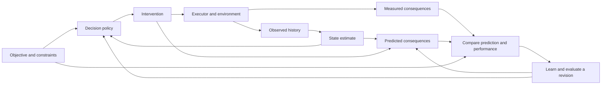

# Cybernetic learning across coding and Go

Literature survey and revision of Lyo's learning direction. Investigated **9 September 2026** against source code at `1238e2b`, primary papers, author repositories, and first-party documentation.

This is a focused investigation, not an exhaustive systematic review or a benchmark replication. Research results, current product mechanisms, and recommendations for Lyo are distinguished below. Recent preprints remain provisional; moving product documentation describes the inspection date, not a pinned release.

## Finding

**The right common abstraction is an adaptive decision loop.** It should connect observations, interventions, measured consequences, and updates to the mechanism that chooses future actions. A lesson library is one possible representation inside that loop.

For coding and baduk/Go, the reusable machinery is experience linkage, delayed feedback, model/policy versioning, evaluation, and adaptation. Each domain still needs its own observations, actions, objective, and evaluator. Sharing an algorithm does not imply that a coding lesson is useful Go knowledge.

The survey changes the earlier recommendation in three ways:

1. Start with the controlled process, objective, available interventions, and measurable feedback. Do not start by designing a catalogue of textual triggers and ranking weights.
2. Separate learning an outcome prediction from learning a better decision policy. A more confident explanation, an accurate prediction, and improved performance are different achievements.
3. Demonstrate a complete adaptive loop on a small decision problem in each domain before broadening collection, retrieval, or automatic memory rewriting.

The closest algorithmic foundations are adaptive control, Dyna and policy evaluation/improvement. AlphaZero and MuZero provide concrete examples of closed learning loops. ExpeL, ReasoningBank and ACE offer useful ways to represent and modify experience for language agents, but do not remove the need for trustworthy feedback.

## 1. What must close the loop

Two loops need to be distinguished:

- **Feedback control:** a new observation changes the next action under an existing controller.
- **Adaptation:** experience changes the model or policy used to choose actions in later situations.

A fixed “on error, retry” rule can be feedback control. An expanding log is neither of these by itself. An adaptive system can also learn something incorrect; changed behavior becomes evidence of improvement only when evaluated against the objective. These distinctions follow the control and learning mechanisms examined in [Ashby](https://ashby.info/Ashby-Introduction-to-Cybernetics.pdf) and [Dyna](https://doi.org/10.1145/122344.122377).

The following is our proposed decomposition for Lyo, rather than a theorem:

The executor can be an LLM, a Go engine, or a person receiving coaching. When Lyo supplies advice, **the advice and the executor's actual action are separate events**. The environment includes the changing codebase or game. The central SQLite ledger stores evidence about this process; it is not itself the controller.

For every learning claim, we should be able to identify:

| Required element | Question Lyo must answer |
|---|---|
| Objective | What outcome should improve, over what horizon and within what constraints? |
| Observation | What information was available before the decision? |
| Intervention | What could Lyo change, including continuing without intervention? |
| Prediction, when the method uses an explicit outcome/value model | What consequence did that model expect? Direct policy improvement need not expose such a prediction. |
| Measurement | What happened, and which independent instrument established it? |
| Update | Which model, procedure, or policy version changed because of this evidence? |
| Subsequent effect | Did the revision change later decisions and improve measured performance? |

## 2. Cybernetics and learning: what the sources establish

### Ashby and the good-regulator theorem

Ashby's requisite-variety argument concerns specified disturbance, response, and outcome mappings. It constrains regulation under those assumptions; it does not count prose lessons or prove that library size must exceed a failure taxonomy. The useful implication for Lyo is to preserve distinctions that require different responses and provide effective actions for them. “Nonzero exit status” alone cannot distinguish a missing dependency from a behavioral defect. [*An Introduction to Cybernetics*, 1956, chapters 11–12](https://ashby.info/Ashby-Introduction-to-Cybernetics.pdf)

Conant and Ashby fix a system-event distribution and an outcome mapping, and study regulators minimizing outcome entropy. Their result constructs a simplest optimum as a mapping from system events to regulator events. This is not a requirement to build an explicit simulator, an explanation graph, or an LLM narrative. Their entropy objective also cannot simply stand in for task success: consistently producing the same wrong output can have low entropy. The theorem motivates examining what a regulator must distinguish; it does not validate Lyo's proposed probabilities. [*Every Good Regulator of a System Must Be a Model of That System*, 1970, especially theorem and discussion](https://pespmc1.vub.ac.be/books/Conant_Ashby.pdf)

### Observability, identification, and adaptive control

Observability asks whether different internal states can be distinguished from observations; system identification estimates unknown dynamics. They are separate problems. Linear observability has precise rank conditions, but arbitrary agent transcripts are not a linear system to which those guarantees automatically apply. [Lall, Stanford EE363, observability](https://ee363.stanford.edu/lectures/011_observ.pdf)

Åström's account connects identification, model validation and controller design. Modern adaptive-control work makes its assumptions explicit: for example, Lu and Cannon combine parameter estimation, constrained control and persistent excitation for a specified linear system class. Their guarantees are not guarantees for LLM behavior. [Åström, *Adaptive Control—A Perspective*, 2018](https://lccc.control.lth.se/media/LCCC2018/WS2018-10/Slides/KJA.pdf); [Lu and Cannon, 2023](https://ora.ox.ac.uk/objects/uuid%3A52fe8d01-5e37-458a-b7d4-8be1a0ae2e31)

**Lyo implication:** collecting many outcomes under the same behavior may leave the effect of alternative actions unidentified. Preserve the actual working directory, code and test revisions, interventions, and action chronology. Seek informative comparisons in resettable experiments. Instrumentation volume is not a substitute for distinguishable causes.

### Dyna: a practical foundation for the learning mechanism

Sutton's Dyna integrates acting, learning and planning. Real experience updates an action model and behavior; planning through the model supplies additional learning opportunities. The model can be imperfect. This gives a concrete meaning to adaptation: experience changes predictions and future decisions. [*Dyna, an Integrated Architecture for Learning, Planning, and Reacting*, 1991](https://doi.org/10.1145/122344.122377)

For Lyo, borrow that separation before considering a full learned simulator. Test an action–outcome prediction against actual evidence; use evaluated experience to revise the decision mechanism. Preserve whether a result was observed, simulated, or predicted. An accurately predicted failed test is useful state information, while its desirability depends on why the test was run.

### AlphaZero and MuZero: working examples across domains

AlphaZero's network predicts move probabilities and game outcome. Search improves the move distribution; self-play supplies positions, search targets and terminal results. Training changes the network used in subsequent games. The terminal result supervises value estimates across positions; it does not certify every move in a winning game as optimal. The paper trains **separate instances for chess, shogi and Go**, using domain rules and encodings. It shares the algorithm, not one already competent cross-game policy. AlphaZero also omits AlphaGo Zero's earlier champion-promotion step. [Silver et al., AlphaZero, inspected December 2017 preprint, algorithm and Methods](https://arxiv.org/html/1712.01815v1)

MuZero adds a learned representation and action-conditioned dynamics model optimized to predict reward, policy and value. It does not need to reconstruct the entire observation. Actual interaction and search generate training targets, with terminal outcomes for board-game value and bootstrapped returns for Atari. Predicted value remains distinct from observed reward. This supports learning decision-relevant state, rather than assuming exhaustive telemetry is itself useful representation. It does not make an LLM judge a ground-truth evaluator. [Schrittwieser et al., MuZero, inspected February 2020 v2](https://arxiv.org/html/1911.08265v2)

### Active inference is an alternative formulation, not a shortcut

Discrete active inference explicitly models hidden states, observations, transitions, preferences and policies. It offers a framework for actions that both pursue preferred outcomes and resolve uncertainty. Using it requires specifying and learning that generative model; naming an error “free energy” supplies none of those components. Its authors' synthesis is a mathematical framework, not evidence of improved coding or Go performance for Lyo. [Da Costa et al., *Active Inference on Discrete State-Spaces: A Synthesis*, 2020](https://arxiv.org/abs/2001.07203)

**Recommendation:** keep this as a candidate formulation if uncertainty-reducing actions become the experimental focus. The present evidence does not justify selecting it over a smaller policy-evaluation loop merely because earlier documentation uses thermodynamic language.

## 3. How agent-memory systems implement parts of the loop

These are useful mechanisms, with different feedback quality and evaluation scope. None should be treated as a ready-made proof of Lyo's intended cross-domain benefit.

| Work | What changes from experience | How it influences later actions | Evidence boundary |
|---|---|---|---|
| [Reflexion, 2023](https://arxiv.org/html/2303.11366v4) | Verbal reflections based on environmental or other feedback | Episodic text informs subsequent attempts | Particularly relevant to retries. Same-task improvement is different from completed-ticket transfer. |
| [ExpeL, inspected 2024 v3](https://arxiv.org/html/2308.10144v3) | Insights from success/failure contrasts and successful trajectories | Task-similar successful examples plus the insight list enter the prompt | Evaluates new tasks. Insight up/down votes are model curation judgments, not experimental measurements of each insight's effect. The inspected implementation includes the full insight list, rather than situational retrieval of individual insights. |
| [Voyager, 2023](https://arxiv.org/html/2305.16291v2) | Reusable executable Minecraft skills | Embedding search over descriptions selects skills for the current task and environment | Demonstrates reuse in Minecraft, with execution feedback and a model verifier. It does not establish arbitrary code-repository transfer. |
| [Dynamic Cheatsheet, 2025](https://arxiv.org/html/2504.07952v1) | Model-curated persistent strategies and prior examples | The retrieval variant synthesizes memory using similar earlier queries before answering | A real memory-update mechanism, but curation lacks ground-truth labels. Weak generators can populate memory with flawed strategies. |
| [ACE, October 2025 v1](https://arxiv.org/html/2510.04618v1) | Itemized playbook entries, incremental deltas, helpful/harmful tags | Generator, reflector and curator adapt context | Local edits avoid repeatedly replacing the whole playbook. Helpful/harmful tags include generator judgments; their names do not make them causal credit. AppWorld/domain results do not predict Lyo's gains. |
| [ReasoningBank, March 2026 v2](https://arxiv.org/html/2509.25140v2) | Structured strategies from self-judged successful and failed trajectories | Task-query embeddings retrieve similar experiences; default is one experience, possibly containing several items | Includes web tasks and SWE-bench Verified. Consolidation is simple append-only addition in the inspected method. Reported end-to-end gains do not establish the marginal causal contribution of each memory. |

A useful contrast is the early [Generative Agents](https://arxiv.org/html/2304.03442v2) ranker: normalized relevance, recency and model-rated importance were combined for social simulation. That is a specific design choice in that environment. It is not an experimentally calibrated intervention-value function for code or Go, so copying those weights would not answer this project's question.

Implemented platforms mostly address persistence and context access:

| System, inspected September 2026 | Reusable mechanism | What remains unestablished |
|---|---|---|
| [Current Letta MemFS](https://docs.letta.com/concepts/memfs), [dreaming](https://docs.letta.com/configuration/memory) | Git-backed memory, small always-loaded `system/` files, on-demand file access, background consolidation after step-count or compaction events | Writing/consolidation timing is distinct from deciding when an intervention improves active work. Current product behavior must be separated from legacy MemGPT experiments and memory blocks. |
| [LangGraph](https://docs.langchain.com/oss/python/concepts/memory), [LangMem](https://langchain-ai.github.io/langmem/concepts/conceptual_guide/) | Long-term namespaces independent of conversations; distinctions between facts, episodes and procedures; application- or agent-directed retrieval | Namespace and similarity determine access/relevance, not causal usefulness. Importance/strength guidance is not a universal learned controller. |
| [Graphiti search](https://help.getzep.com/graphiti/working-with-data/searching), [Zep paper](https://arxiv.org/html/2501.13956v1) | Separate retrieval, reranking and context construction; temporal invalidation preserves superseded facts | Query relevance and temporal fact validity differ from behavioral intervention value. Memory-QA results do not demonstrate better coding decisions. |

For Lyo, these support keeping evidence, learned representations, and delivered context distinct. They do not justify replacing SQLite or adopting another framework before the learning experiment works.

## 4. The evaluation literature changes what counts as proof

**Transfer must be tested separately from memory construction and routing.** AFTER fixes task-to-skill annotations specifically to isolate skill quality. Its 382 workplace tasks include role/model transfer tests; the reported PDF-skill cross-role experiment loses 4.8–7.5 points despite source-role gains. It therefore supports testing transfer and warns about specialization. It does **not** validate an automatic router or unseen-repository deployment. [Belikova et al., *Managing Procedural Memory in LLM Agents*, June 2026 v1 preprint](https://arxiv.org/html/2606.23127v1)

**Updates can destroy useful knowledge.** Experiments in *Useful Memories Become Faulty* compare raw episodes and evolving abstractions, finding loss of applicability conditions and merging of incompatible situations in tested systems. Its revised experiments include memory controls and an individual-workflow removal test. These are reasons to evaluate revisions against retained cases, not a theorem that all summarization fails. The single-workflow experiment has limited replication. [Zhang et al., inspected 29 August 2026 v2 preprint](https://arxiv.org/html/2605.12978v2)

**Remembering and acting require different tests.** MemoryArena measures interdependent multi-session tasks with actual actions, feedback and latency. Its sessions intentionally belong to connected goals, so it does not establish transfer to unrelated completed tickets. [He et al., February 2026 v1](https://arxiv.org/html/2602.16313v1)

LongMemEval-V2 now includes workflow knowledge and environment gotchas, beyond personal-fact recall. It still evaluates answering questions from remembered experience, rather than completing new work. A good diagnostic for evidence retrieval must not be reported as an execution-success score. [Wu et al., May 2026 v1, work in progress](https://arxiv.org/html/2605.12493v1)

The author implementation of AgentMemoryBench distinguishes frozen offline evaluation, online updates, transfer, forgetting and repair after bad feedback. These are useful separate experimental modes. Its workshop PDF was inaccessible during this investigation, so no numerical result is relied on here. [Official repository](https://github.com/solomoon313/AgentMemoryBench); [ICLR 2026 workshop record](https://openreview.net/forum?id=MSXbrNExax)

**Logged outcomes do not reveal all alternative outcomes.** Doubly robust policy evaluation combines reward modeling and propensity correction for contextual bandit feedback. Its assumptions and support requirements matter: a never-tried action does not acquire identifiable value just because the log is large. Accurate propensities cannot repair an invalid outcome definition. Sequential actions also require handling their effects on later states, rather than treating every tool call as an independent bandit trial. [Dudík, Langford and Li, ICML 2011](https://arxiv.org/pdf/1103.4601)

For Lyo, randomized episode-level comparisons can establish an average intervention effect without reconstructing the unobserved outcome of each individual run. Full per-run counterfactual explanation is a stronger claim and should not be a prerequisite for any learning. Equally, an LLM's imagined alternative is a hypothesis, not another observed trial.

## 5. Where Lyo's ambition, documents and implementation differ

The existing [explanation-graph direction](../docs/learning-as-explanation-graph.md) already defines learning as inference, intervention and feedback. The gap is making those operations empirically meaningful and connecting them to decisions. The current [evidence-loop specification](../Specs/8-learning-evidence-loop.md) appropriately distinguishes observations from causal credit and reports an inconclusive experiment.

| Inspected component | What exists | Consequence for the revised design |
|---|---|---|
| [Session hook](../src/lyo/selection/session-hook.ts) | Verifier lessons match exact `repoPath`; at most one banner per identified session; up to five sampled entries | Repository provenance substitutes for task state; delivery cannot adapt to observations arising later in the session. |
| [Selection policy](../src/lyo/selection/selection-policies.ts) | Thompson sampling from per-lesson Beta parameters | The sampler has no current-state representation. Bayesian arithmetic does not supply missing contextual outcome evidence. |
| [Decision storage](../src/lyo/storage/lesson-store.ts) | A richer selection path records candidates and estimated inclusion probabilities; its null arm represents an empty candidate set | The native banner samples directly. Neither a full native decision record nor an experimentally selected no-intervention comparison follows automatically. |
| [Session bridge](../src/lyo/bridge/session-bridge.ts) | Completed-session failure/pass patterns create scoped verifier candidates; outcome records explicitly use `causalCredit: false` | Correctly preserves observations without claiming benefit. It does not learn an action-value model from them. |
| [Controlled experiment](../evidence/learning-loop-2026-09-08-r2/assessment.md) | Corrected experiment recorded 0/8 successes in each condition | The mechanism was exercised; product improvement was not demonstrated. |

The four recently reviewed work-repository entries remain historical candidates. Their failure/pass pairs are useful source episodes, not four validated control policies. The recovery review found examples involving a SQL comment, test parsing of renamed CTEs, and ordinary red/green development. The recovery review is a local-only artifact at `~/.lyo/learning-runs/2026-09-09T031457Z-work/review.md`; it is not included in this checkout. Its observations motivate investigation; they do not identify causal benefits of advice never delivered in those episodes.

### Corrections to earlier literature interpretations

The [July literature notes](../Specs/1.1-learning-layer-literature.md) contain useful references but overstate several conclusions. This review supersedes those interpretations:

1. **Requisite variety is not a lesson-count inequality.** The regulator's discriminations and available responses matter; the theorem does not prove `number of lessons ≥ number of failure classes`.
2. **The good-regulator theorem does not mandate explanation graphs.** Explicit narratives are neither necessary nor sufficient evidence of an effective model.
3. **Helpful/harmful names do not define a reward.** ACE's curation tags, task success, and intervention benefit must remain distinct.
4. **A failed verifier can be a successful diagnostic action.** The older [experiment protocol](../docs/cybernetic-learning-experiment-protocol.md) proposes weakening a verifier association when its run fails without recovery. That observation alone does not establish verifier uselessness; it may have detected exactly the relevant defect. Test coverage and completed-task quality require different measurements.
5. **Hand-picked factor values are assumptions.** Multiplying and normalizing example scope/freshness/rival factors does not turn them into calibrated likelihoods. Correlated evidence can be counted repeatedly. A temporal feedback cycle also does not automatically imply a cyclic probabilistic factor graph after time is unfolded.
6. **Data processing does not prove inevitable memory collapse.** The earlier appendix's inequality permits equality: repeatedly copying a memory is a counterexample to guaranteed loss. Its `q^k` decay needs an additional retention model; access to new evidence also changes the proposed Markov chain. ACE's observed collapse is empirical evidence, not proof of those broader mathematical assertions.
7. **No novelty claim is established here.** The reviewed work leaves gaps for Lyo's use case; it does not prove that nobody else performs intervention evaluation or that causal discovery is always the bottleneck.

Causal-discovery papers in the local reading collection may help when a particular structural model is justified. They do not replace identification of Lyo's observations, actuator, objective and evaluation protocol.

## 6. Revised domain-general design

This section is a proposed research design. It is not a description of implemented capability.

### Define the same loop with different domain instruments

| Role | Coding | Baduk/Go |
|---|---|---|
| Controlled process | Agent changes artifacts to satisfy a ticket | Player/engine chooses moves during a game |
| Observation | Requirements, revision, actual tool results and execution context | Position, side to move, relevant history, rules and clock |
| Lyo's actuator | Initially, a choice of additional inspection, verification, procedure or advice | Initially, a choice of analysis effort or advice; direct moves only if Lyo owns play |
| Actual action | Tool use, edit, check execution, or ignored advice | Played move/pass, analysis performed, or ignored advice |
| Measured consequence | Behavior under frozen independent checks; completed requirements | Rules-based terminal result; declared position/task evaluation |
| Prediction | Expected result or future completion value under an action | Expected result/value under a continuation |
| Resource constraint | Time, tools, tokens, permitted side effects | Time, visits/compute, legal play |
| Transfer test | Later ticket and held-out repository | Unseen positions/games and declared opponents |

An engine's evaluation is a prediction or teacher signal, not a played game's observed result. A passing code test establishes only what that verifier tests. Every signal needs its evaluator version, scope and provenance.

The initial actuator should be the **outer decision policy that Lyo can actually change**. This makes the proposal compatible with hosted coding agents whose base weights Lyo cannot train. A procedure or prompt can be part of that policy representation. For an open Go or language model, parameter training is another possible actuator, with a different experiment and resource requirement. We should not conflate those targets.

### Replace hand-ranked tips with policy evaluation and improvement

Let `h_t` be the observations and actions available so far, `u_t` an allowed intervention, and `π_v` a versioned decision policy. The policy chooses `u_t` from `h_t` and the objective. A domain evaluator later supplies the measured return over a declared horizon. The learning target is the expected return of decisions under that policy, subject to explicit constraints.

The operational sequence is:

1. Record the pre-decision history and possible actions, including continuing normally.
2. Record the policy's action and any predicted consequence, before observing the result.
3. Link the intervention to the executor's actual response and delayed outcome.
4. Update the outcome model or propose a policy revision using those linked experiences.
5. Evaluate the revision against the previous version on independent comparable episodes.
6. Use the measured result to retain, reject or revise it; then observe its subsequent decisions.

A one-decision episode can use a contextual bandit with properly defined feedback. A sequence whose actions change future opportunities needs sequential value learning or policy evaluation. Thompson sampling is a possible exploration algorithm in the former setting; global per-lesson votes do not solve the latter. Neither requires manually assigning a “relevance × importance × recency” score.

For a first reproducible experiment, a small finite state/action problem with empirical outcome estimates is sufficient to expose the update mechanism. Scaling its representation to open-ended coding or Go is a subsequent research question. A rich probabilistic graph should earn its place by improving prediction or decisions over this baseline.

### Timing is a decision variable

We should expose decision opportunities at actual observations and action boundaries: task entry, tool completion, or a new Go position. The policy can continue without intervention, gather information, or act. It can learn whether spending effort now improves the declared objective. A session-opening banner alone cannot implement that loop.

Memory retrieval may help construct a state estimate or propose actions. It does not independently decide that an intervention is beneficial. Repository paths and old commands remain evidence provenance; the new environment supplies the actual available actions. This permits a policy learned from previous tickets to be evaluated on a different repository without assuming the old files exist there.

There are also different update cadences: state estimates can change after each observation, delayed credit attaches when the relevant outcome arrives, and a policy revision can be evaluated between episodes. Rewriting the policy after every noisy tool result is not required for timely feedback.

### Keep the objective separate from its sensors

Start with task success under a fixed resource cap and explicit correctness constraints, reporting cost separately. This avoids inventing a single weighted score that trades away correctness for fewer tool calls. Future trade-offs should express the user's objective and be tested, rather than emerge accidentally from available telemetry.

Retain both prediction error and performance error. A test that finds a defect can improve knowledge while the ticket remains unfinished. A Go value estimate can become better calibrated without improving the current move policy. Conversely, a policy can improve play without producing a readable verbal lesson.

## 7. Smallest experiment that would demonstrate the ambition

**Build one complete loop, then run its shared protocol in both domains.** This is the recommended next work, not work performed by this survey.

1. **Select a bounded decision and objective.** A useful common research question is when additional checking/analysis is worth its cost. In coding, compare continuing work with a specific verification/inspection action. In Go, compare playing under the current analysis budget with spending additional analysis. Keep the initial solver fixed to isolate the outer controller.
2. **Make both environments resettable.** Use code snapshots with frozen independent acceptance checks; use held-out Go positions or games with declared rules, opponents and compute limits. Changing tests or teacher versions creates a different evaluator, not directly comparable feedback.
3. **Collect comparable action outcomes.** Randomize admissible choices in the experimental harness, or evaluate both from resettable starting states with replicated runs. Log what was actually chosen and observed. Do not infer alternative outcomes by replaying transcript text.
4. **Produce a candidate learned controller.** Fit outcome estimates or revise a policy from training episodes. Record exactly which evidence changed which predictions or choices. Keep the objective and evaluator outside the learner's editable policy.
5. **Evaluate frozen versions.** Compare the original controller, the learned controller, and an ordinary fixed-policy baseline under matched budgets. Report success, uncertainty, cost and regressions. The baseline is an experimental control, not the proposed learning mechanism.
6. **Test ongoing adaptation separately.** For an online run, evaluate each arriving episode before allowing its feedback to update the next version. Include retained cases to reveal forgetting and deliberately wrong feedback to test correction. Do not mix this score with frozen-controller evaluation.
7. **Connect the successful loop to daily hosts.** Codex, Claude, ECA/Qwen and Bob should translate host events into the same experience/decision/feedback records. A hook firing or a tool being installed is an integration result; a changed evaluated policy is a learning result.

Split data by whole tickets/games and underlying source, not event rows. Worktree copies, repeated sessions and related ticket variants must not cross training/evaluation boundaries as independent evidence. Report later-ticket, held-out-repository and task-family transfer separately. For Go, prevent the same game or symmetry-equivalent position from leaking across splits where it would invalidate the intended claim.

Predeclare how improvement will be judged, and retain uncertainty when the sample is too small. One successful loop execution demonstrates plumbing. Repeated performance improvements on held-out cases demonstrate a useful learned controller within that scope. Neither establishes universal transfer between coding and Go.

## 8. Recommended reading order

1. **Ashby, chapters 11–12; Conant–Ashby with the theorem's assumptions.** Establish what regulation means and correct the earlier overclaims.
2. **Dyna, then AlphaZero and MuZero.** Follow experience all the way to a changed decision mechanism.
3. **Dudík et al. on policy evaluation.** Understand what logged feedback can identify and why action probabilities and comparisons matter.
4. **ReasoningBank and ExpeL.** Study practical experience representations for a language-agent actuator.
5. **AFTER and Useful Memories Become Faulty.** Design transfer and update-regression tests before automatic consolidation.
6. **ACE and the current platform documentation.** Borrow storage/update mechanisms after the loop's measurements and update target are concrete.

The immediate deliverable should be an executable experiment with a declared update rule and two domain mappings. More collected SQLite rows, more generic lessons, or a more elaborate score would leave the central question unanswered.
