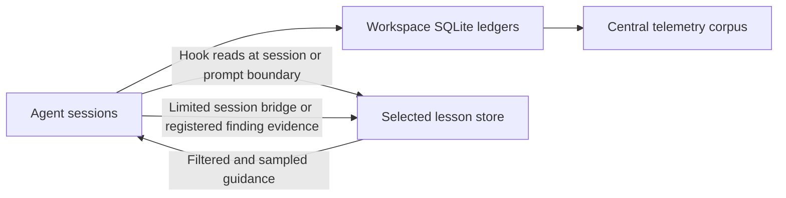

# Managing and validating reusable lessons: research assessment

Research date: 2026-09-10. This is a targeted primary-source assessment, not an exhaustive survey or a claim to identify a universally best memory system. The intended LYO outcome is: retain a specific lesson, deliver it when applicable, observe its use and consequences, then revise its wording or applicability using later evidence.

**Assessment:** useful precedents exist for each part, but none of the systems examined establishes that arbitrary individual advice should be promoted across repositories merely because subsequent work succeeds. ACE is the closest design precedent for maintaining reusable advice; contextual intervention experiments supply a stronger basis for deciding when advice actually helps. A larger memory graph alone does not close that gap.

## Where information flows today

Code inspected at `d628587`, with the live-store observations gathered during this session on 2026-09-10. Here, a node means an agent session working in a workspace; these are processes on the same machine, not a deployed network of independent learning servers.

**LYO has distributed collection, central aggregation, and local retrieval from a usually shared lesson store. It does not have a lesson broadcast/subscription service or a complete learned routing policy.** Central storage and local selection are separate architectural choices.

The central telemetry corpus is normally `~/.lyo/corpus.sqlite`. The default shared lesson store is a different database, `~/.zeroshot/lyo-lessons.db`. Synchronizing telemetry does not automatically convert arbitrary failures into useful, validated lessons. The current live sync root is `~/repositories/work`; historical imports from elsewhere do not establish continuous collection from every `~/repositories/*` directory.

The exact ordinary-session selection path is:

| Step | Current behavior | Relevant code |
|---|---|---|
| Choose a library | First existing store: `ZEROSHOT_LYO_STORE_PATH`, then `<cwd>/.zeroshot/lyo-lessons.db`, then the home store. A local store takes precedence; stores are not merged for this read. | [session-hook.ts](../src/lyo/selection/session-hook.ts), `resolveSessionLessonStorePath`, line 59 |
| Select ordinary lessons | Read active and candidate entries. Session-verifier lessons require an exact repository-path match. Other entries need nonempty advice but have no task-semantic eligibility check in this path. | [session-hook.ts](../src/lyo/selection/session-hook.ts), `selectSessionLessons`, line 101 |
| Rank ordinary lessons | Thompson-sample helpful/harmful counts plus any semantic-prior pseudo-counts. The sampler receives lesson ID, alpha, and beta, not the current task or intended tool action. Five total banner slots, reduced by finding slots. | [selection-policies.ts](../src/lyo/selection/selection-policies.ts), `THOMPSON_BETA_POLICY` |
| Select scoped findings | Match Git common directory or a literal prompt tag such as `[lyo:experiment-design]`; maximum three. The schema currently has only three activities: transfer review, experiment design, and learning budget. | [session-findings.ts](../src/lyo/interface/session-findings.ts), `selectSessionFindings`, line 126 |
| Deliver | Ordinary advice normally prints once per session. Newly matching finding versions can print at a later prompt. Delivery is recorded, and the receiving agent is asked to judge relevance. | [session-hook.ts](../src/lyo/selection/session-hook.ts), `emitSessionLessons`, line 148 |
| Feed back | Session-end command observations explicitly avoid causal credit. Registered finding opportunities support paired capture and review, but routine relevance judgments do not automatically become applicability revisions. | [session-bridge.ts](../src/lyo/bridge/session-bridge.ts); [session-finding-workflow.ts](../src/lyo/interface/session-finding-workflow.ts) |

Thus a repository match is currently a substantial part of routing. It is not an estimate that a particular agent will benefit from a particular lesson now. The name `semantic-prior` refers to a proposed lesson's confidence, not semantic matching against the recipient's current need. Shared records make cross-session access possible; they do not establish decentralized learning.

## Wiener: value depends on a changing recipient and environment

The supplied passages occur in chapter VII, printed pages 119–121 of the inspected edition. Wiener discusses both familiarity reducing the informative value of a message and changing conditions reducing the usefulness of stored know-how. His argument concerns communication and social organization; it does not prescribe a distributed database or a numerical time-decay rule. [Wiener, *The Human Use of Human Beings*, 1950/1954; inspected 1989 reprint](https://library.agnescameron.info/cybernetics/The%20Human%20Use%20of%20Human%20Beings,%20Norbert%20Wiener%20(1950).pdf#page=145).

**LYO design inference:** distinguish a lesson remaining true from a reminder remaining useful. A quoting rule might still be correct, while a newer agent already follows it reliably. Its incremental delivery value then falls without falsifying the rule. Conversely, an execution-interface change can invalidate its preconditions even if the text is unfamiliar to the agent. Novelty itself is not evidence of practical benefit.

Preserve historical observations, but re-evaluate the current delivery decision against the recipient, task, tool/runtime versions, relevant environmental changes, and later results. A timestamp is useful provenance; an arbitrary expiry date cannot establish invalidity. Repeatedly delivering true but already-internalized advice can produce the kind of informational repetition the user is concerned about.

### Broadcast and local selection are compatible with a shared ledger

SIENA's content-based publish/subscribe service routes notifications according to predicates supplied by consumers. Its distributed algorithms propagate subscriptions or advertisements and avoid unnecessary notification traffic. Broadcasting everything and filtering locally is an alternative it examines, not the definition of publication. The evaluation studies communication and scalability, not whether recipients learn from messages. It also compares a centralized baseline and favors its simplicity where adequate. [Carzaniga, Rosenblum and Wolf, TOCS 2001, sections 3–6](https://www.inf.usi.ch/faculty/carzaniga/papers/crw_tocs01.pdf).

**LYO design inference:** each node should express its current task/action context, retrieve candidates, and check applicability locally. Publication can initially mean a versioned entry in the shared SQLite store; hooks can query it at meaningful boundaries. A network broker is unnecessary for the present single-machine arrangement. If notifications are later needed, advertise changed IDs, versions, and scope metadata; fetch full advice only for interested sessions. Retraction/version checks must reach consumers too. Faster transmission alone cannot improve selection.

ADWIN provides a statistical approach to changing streams: compare means across older and newer subwindows and discard old observations from the current estimator when a significant change is detected. It detects changed statistics, not their cause. Its theoretical setup uses independent bounded observations. [Bifet and Gavaldà, *Learning from Time-Changing Data with Adaptive Windowing*, sections 3.1–3.2](https://www.cs.upc.edu/~Gavalda/papers/adwin06.pdf).

**LYO design inference:** monitor current usefulness and changed premises before adding a drift detector. Sparse, correlated session outcomes do not automatically meet that detector's assumptions. Keep evidence history even when the current applicability estimate changes.

## Primary agent-memory research

### Reflexion — outcome feedback becomes a retry memory

Reflexion separates acting, evaluation, and reflection. An evaluator scores a trajectory; a language model converts feedback into a short explanation; subsequent attempts receive that explanation. The memory usually retains only one to three reflections. Evaluation differs by domain: exact-match answers, environment completion signals, heuristics, or generated tests. In ALFWorld, failed tasks are reset and retried; in HotpotQA, exact-match feedback controls further trials. An ablation compares reflection with retaining the prior trajectory and reports an eight-point advantage for reflection in that setup. These are meaningful system-level comparisons, but the principal loop improves attempts on the same problem. The inferred explanation of failure is not independently established as the cause, and a successful retry does not identify the effect of any particular sentence. There is no general lifecycle for testing a lesson across unrelated future contexts, retracting it, or estimating a contextual treatment effect. [Shinn et al., NeurIPS 2023, sections 3–4, especially 4.1–4.3](https://arxiv.org/html/2303.11366v4).

**LYO implication (design inference):** use reflection to propose a testable hypothesis. Keep its explanation separate from the observed failure/pass evidence and from later claims of benefit.

### Voyager — retain executable skills after checking task completion

Voyager stores successful executable programs, indexed by embeddings of generated descriptions. Retrieval uses a generated task suggestion plus environment feedback to select five relevant skills. Execution errors, environment observations, and a GPT-4 critic drive program revision; a skill enters the library after the critic judges the task complete. The transfer experiment resets inventory, creates a new Minecraft world, and tests four unseen goals over three attempts each. The complete system solves all four in all three attempts; the no-library ablation also solves most, but generally takes more prompting iterations. Giving the library to AutoGPT improves some tasks, demonstrating reuse across agent implementations. This supports a reusable action library under a shared environment/API and gives stronger transfer evidence than a same-task retry. It does not establish arbitrary cross-domain validity, nor provide calibrated per-skill harmfulness or a systematic scope-contraction rule. The admission check is a model assessment of completion rather than an independent causal estimate. [Wang et al., sections 2.2–2.3, 3.3–3.4, table 2](https://arxiv.org/html/2305.16291).

**LYO implication (design inference):** retain the smallest actionable procedure, its preconditions, and its verifier. Test the same procedure in genuinely new but explicitly comparable contexts.

### A-MEM — update the contextual representation of existing memories

A-MEM turns an interaction into an atomic note containing source content, time, generated keywords, tags, a contextual description, an embedding, and links. It first retrieves similar notes and then asks an LLM whether to connect them. New notes can revise the context, keywords, and tags of earlier notes; retrieval combines semantic similarity with related memories. Thus older memories can change as new evidence arrives instead of remaining fixed. The experiments concern long-conversation question answering, including LoCoMo and DialSim, with answer-overlap metrics. In the GPT-4o-mini ablation, multi-hop F1 is 27.02 for the full method versus 21.35 without memory evolution and 9.65 without linking and evolution. These results support organization and retrieval in those benchmarks. They do not show that semantic links identify causal mechanisms, that revised advice prevents future task failures, or that an individual memory has demonstrated benefit. Replacing a note with an LLM-generated evolution also does not itself supply an auditable evidential retraction mechanism. [Xu et al., sections 3.1–3.4 and 4.1–4.4, table 3](https://arxiv.org/html/2502.12110v11).

**LYO implication (design inference):** allow context descriptions to evolve, but preserve original observations and version the proposed revision. Semantic similarity proposes applicability; later outcomes must test it.

### ACE — an evolving playbook with localized correction

ACE uses a Generator, Reflector, and Curator to turn execution trajectories into reusable playbook entries. Bullets have stable identifiers and helpful/harmful counters. The Generator identifies useful or misleading bullets; reflection proposes changes; curation emits small deltas, merged deterministically. Local updates and embedding-based deduplication avoid rewriting the entire playbook. In AppWorld, online ACE without ground-truth labels reports a 59.5 aggregate score versus 42.4 for the base ReAct configuration. The paper also ablates incremental updates and reflector quality. In a FiNER stress test, adversarial reflection at every update reduces accuracy below the base model; less frequent corruption is tolerated better. These comparisons support the architecture under tested conditions. However, bullet helpfulness is model-attributed feedback, not randomized individual-lesson credit. Whole-system gains cannot certify every bullet. Contradiction detection and additional outdated-entry pruning are discussed as compatible safeguards, not a proven general theory of validity. [Zhang et al., version 3, sections 3, 4.3, appendix A.4–A.5](https://arxiv.org/html/2510.04618v3).

**LYO implication (design inference):** reuse stable lesson IDs and small versioned changes, with explicit correction proposals. Do not present model-assigned helpfulness counters as measured causal benefit.

## Primary references for timely intervention evaluation

### Micro-randomized trials and just-in-time adaptive interventions

Micro-randomized trials repeatedly randomize an intervention option at eligible decision points during ordinary activity. They target a specified proximal outcome and examine how the intervention's effect depends on changing context and time. The paper explicitly distinguishes occasions when the participant is available for treatment and requires an availability indicator in each data row. Effects among currently available occasions can change because the available population changes; the authors discuss estimating this time dependence and separately examining changes in availability. Repeated observations require an appropriate longitudinal analysis, not treating each row as an unrelated experiment. This is a design and analysis framework for learning when an intervention works, with illustrative health applications and power calculations. It is not empirical evidence that LYO's prompts help. Its fit is architectural: insert an optional intervention at a meaningful moment and measure the ensuing response. Reliable, low-burden proximal outcomes and carefully defined eligibility are prerequisites. [Klasnja et al., Health Psychology 2015, design, analysis, participant availability, and limitations](https://pmc.ncbi.nlm.nih.gov/articles/PMC4732571/).

### Doubly robust contextual-policy evaluation

Dudík, Langford, and Li formalize logged contextual decisions: observe context, select an action using a potentially history-dependent policy, and observe only that action's reward. Direct evaluation predicts rewards; inverse-propensity evaluation corrects for the logging policy's action proportions. The doubly robust estimator combines them and reduces sensitivity to error in one model when the other is correct, under the paper's assumptions. This does not mean arbitrary logs yield unbiased causal conclusions. The formulation assumes examples from a distribution over context/reward pairs; the relevant selection probabilities must be known or adequately modeled. Its analysis separates nuisance-model fitting from evaluation data. Unsupported actions cannot be evaluated reliably by importance weighting, and rare action probabilities can create large variance. Experiments include classification converted into partial feedback and a web-visit estimation problem with known sampling probabilities. They do not establish validity for long action sequences, model drift, or missing task acceptance. [Dudík et al., ICML 2011, sections 2–5](https://icml.cc/2011/papers/554_icmlpaper.pdf).

## Proposed LYO mechanism — synthesis, not a result proved by these papers

The missing unit is a **versioned contextual intervention**, not another global score. Reuse the existing ledger and receipt machinery to connect the following information:

| Record | Minimum meaning |
|---|---|
| Candidate version | A specific instruction, proposed mechanism, source observations, and explicit uncertainty. |
| Applicability version | Preconditions, exclusions, the decision moment, and which target contexts remain untested. |
| Opportunity | Context recorded before delivery, eligibility decision and reason, agent/runtime, and independent task/session identity. |
| Assignment and delivery | Eligible options including no added advice; selected option and its probability; exact delivered version; whether delivery succeeded. |
| Application | Whether and how the action followed the advice; retain unknown when observation is incomplete. |
| Outcome | A predefined near-term check plus task acceptance/regressions; verifier identity/version, timestamps, evidence references, and missingness reasons. |
| Revision | The evidence motivating a wording change, scope change, suspension, or continued uncertainty; retain previous versions and counterexamples. |

This distinguishes three questions that a single helpful/harmful count confuses:

1. **Is the advice technically valid under these conditions?** Reproduction and boundary checks can test its stated mechanism.
2. **Does delivering it change behavior?** A receipt proves delivery; observing the advised action provides different evidence.
3. **Does that delivery improve the result here?** Compare outcomes under defensible assignment and measurement, rather than attributing any subsequent pass to the advice.

### An ordinary-session experiment that does not require revisiting a ticket

Define opportunities by an action and its preconditions, rather than by repository name. For example, a shell-quoting candidate may be relevant immediately before submitting multiline Python through a shell. A path-resolution candidate may be relevant after changing workspace and before a batch of file reads. The actual instruction must be scoped to the observed failure mechanism; “always use a heredoc” is too broad when the shell and execution interface differ.

Across later comparable opportunities, evaluate optional added guidance against the normal workflow. Record eligibility and allocation before observing the result. Start with one active experimental lesson per opportunity so credit is interpretable. Do not deliberately introduce a known broken command or withhold a required correctness check to create failures. If randomization is inappropriate, collect observational support with its weaker attribution stated explicitly.

For LYO, an initial proximal outcome could be whether the intended command parses and runs against the intended location. That is narrower than ticket acceptance; retain both. A pass in a selected subgroup that followed the instruction is useful diagnostic evidence, but selecting that subgroup after assignment can bias causal comparisons. Evaluate the effect of assignment separately from adherence.

Minimum analysis constraints: use unique independent task/opportunity identities rather than duplicated telemetry rows; retain non-delivery, non-application, and missing outcomes; log concurrent guidance; account for clustering within sessions and carryover from earlier advice. Keep a stable policy/lesson version during a comparison, or explicitly model the changes. Probability logging is necessary for policy evaluation but cannot repair a bad outcome measure or remove unobserved confounding by itself.

### Promotion and revision

Treat promotion as a change in the delivery policy for a specified context. Technical validity and intervention benefit should have separate evidence states. A verified deterministic lesson may be usable before comparative benefit is established; describe it accordingly. Broader-context trials should be labeled exploration, with new-context outcomes kept distinct from evidence in the established scope.

After later failure, first check measurement, application, and verifier coverage. Then distinguish a false claim from a missing precondition or a delivery problem. Preserve the counterexample; propose a new version with narrower scope or corrected wording; confirm it on later evidence. Do not carve arbitrary exceptions around every failure to protect the original claim. If no defensible boundary exists, suspend the claim.

No cited paper supplies a universal number of wins that makes advice generally valid. Confidence thresholds and minimum evidence must reflect the chosen effect, variation, error tolerance, and independence of observations. Broadening “until failure” is an exploration strategy, not proof of universal transfer; success in observed contexts leaves unobserved contexts uncertain.

## Source inspection and boundaries

The four agent papers were inspected beyond abstracts, including method and evaluation/ablation sections linked above. The ICML policy-evaluation PDF was inspected at its problem formulation, estimator, and variance analysis. The micro-randomized-trial paper's method/availability discussion was accessible through indexed full-text excerpts; direct PMC opening intermittently returned browser verification. None of these sources was used as proof that the current LYO implementation works.

## 임성빈 교수: lecture and related primary work

### The actual lecture

I retrieved the 126-page **Causal Discovery with Generative AI** deck dated **2024-08-29**, linked from Sungbin Lim's official presentation list. Inspected sections include causal distributions (slides 106–108), score-based discovery assumptions (112–114), the causal hierarchy and foundation models (116–118), and incorporating prior knowledge (119–125). The lecture distinguishes observational, interventional, and counterfactual distributions, and positions language-model knowledge as assistance to causal discovery rather than a substitute for identification assumptions. Its references include Pearl's causal-inference overview, Schölkopf et al.'s causal representation learning, SCORE, DiffAN, and work on foundation-model causal knowledge. This is a causal-discovery tutorial, not a lesson-management or message-routing system. [Official presentation list](https://www.sungbin-lim.net/); [lecture slides](https://www.dropbox.com/scl/fi/he0t5goaovk6hr6g7qbdf/CausalDGM.pdf?rlkey=qv3zdq55q0jdbvmlnru6wo7n8&dl=0).

**LYO inference:** an agent may propose an explanation and transferable preconditions. That proposal is different from observing what happened after advice, and different again from identifying what the advice changed.

### SciNO — evidence-conditioned causal ordering

SciNO combines a language-model prior over the next variable in a causal ordering with data evidence derived from Hessian-diagonal variance statistics. Section 3.3, equation 8 and Algorithm 1 specify that combination; variables without semantic descriptions receive a uniform prior. The data term belongs to an ordering-based causal-discovery model with explicit structural/noise assumptions. Evaluations concern causal graphs, not prompt usefulness. [Kang et al., NeurIPS 2025, sections 2, 3.2–3.3 and 4](https://arxiv.org/html/2508.12650v2).

**LYO inference:** separate proposed prior knowledge from measured evidence and allow evidence to alter selection. LYO's Beta pseudo-counts and global prior-agreement tempering do not implement SciNO's likelihood or inherit its causal guarantees. The analogy in existing project notes between derivative accuracy and assigning lesson credit is a metaphor, not a mathematical equivalence. A diffusion model or causal graph over lessons is not justified by this paper alone.

### ORCA — keep causal analysis consistent across stages

ORCA uses an orchestrator, specialist roles, persistent artifacts, and review checkpoints to maintain consistency between data preparation, graph construction, identification, and effect estimation. Its study involved 12 participants and two tasks on the same semi-synthetic relational database with known causal structure. The baseline also had basic persistent state. This tests an assisted causal-analysis workflow, not lifelong cross-domain lesson management. [Chung, Lee and Lim, CHI EA 2026, sections 2–3 and appendix E](https://arxiv.org/html/2508.21304v3).

The abstract's reported 42-point end-to-end completion improvement is not directly reconciled with Table 1's task-completion figures of .75 and .83. Different definitions may explain it; this assessment does not use the headline as established quantitative evidence.

**LYO inference:** bind claim, context, evaluator, observation, and decision to consistent versions. Reopen downstream conclusions when a premise is withdrawn. Existing functions and ledger records can implement that discipline; adopting several agents is not required.

## Transfer and repeated evaluation

Pearl and Bareinboim formalize transfer of causal effects using assumptions about which mechanisms differ between source and target populations. Selection diagrams make those differences explicit; source success alone does not identify every target effect. [*External Validity: From Do-Calculus to Transportability Across Populations*, Statistical Science 2014, section 4](https://ftp.cs.ucla.edu/pub/stat_ser/r400-reprint.pdf).

**LYO inference:** broadening a lesson's scope is a new claim about shared mechanisms and relevant context differences. Record it as a proposed applicability version and test it in later target contexts. Code and Go can share the ledger/control loop while requiring separate observations, legal actions, and evaluators. Do not transfer a coding success estimate directly to Go.

Howard et al. develop confidence sequences valid across a sequence of assessment times under stated conditions; ordinary fixed-sample intervals need not retain their error guarantees under repeated monitoring. [*Time-uniform, nonparametric, nonasymptotic confidence sequences*, introduction and section 4](https://arxiv.org/pdf/1810.08240). Bibaut et al. additionally show how contextual adaptive sampling complicates inference, requiring conditions including sufficient exploration and appropriate variance estimation. [*Post-Contextual-Bandit Inference*, NeurIPS 2021, sections 2–3](https://proceedings.neurips.cc/paper_files/paper/2021/file/eff3058117fd4cf4d4c3af12e273a40f-Paper.pdf).

**LYO inference:** begin with a declared comparison and assessment schedule, or use an appropriate sequential analysis with its assumptions checked. Repeatedly thresholding a Wilson interval over fractional, weighted credit is not automatically a valid test of incremental benefit. More sophisticated estimators cannot rescue absent treatment assignment or invalid task outcomes.

## What the code already supports, and what is missing

| Responsibility | Existing support | Remaining gap |
|---|---|---|
| Durable observations | [Workspace sync](../src/corpus/workspace-sync.ts) and central import; narrow [session-end lesson bridge](../src/lyo/bridge/session-bridge.ts). | General failure/correction evidence does not routinely become a versioned, testable candidate. The two new quoting/path candidates remain audit observations. |
| Delivery and local relevance | Banner reads, repository filters, activity tags, and receipts in [session-hook.ts](../src/lyo/selection/session-hook.ts). | No ordinary action-context subscription or learned context-dependent routing. Local stores can shadow shared knowledge. |
| Evidence integrity | [Finding evidence](../src/lyo/interface/session-finding-evidence.ts) binds observations, action capture, evaluator semantics, hashes, and withdrawals. | Capture depends on a registered opportunity; incremental benefit is explicitly `unknown`. |
| Revise validity | [Finding state and revision](../src/lyo/interface/session-findings.ts) suppress contradicted or stale revisions; preserve versioned support. | New wording is supplied explicitly. Inapplicability requests scope review but does not learn replacement preconditions or expand scope. |
| Promote lessons | [Legacy status rules](../src/lyo/storage/lesson-store.ts), `applyStatusRules`, line 930, use at least eight weighted outcomes and Wilson thresholds. | This does not establish benefit from delivering the lesson, independent task replication, or transfer. The ordinary banner bypasses the fuller `selectWithDecision` log. |
| Compare interventions | [Evaluation gate](../src/eval/report.ts) and [task experiment report](../src/eval/task-report.ts) retain acceptance, baseline, regressions, and cost. | Task reports remain `experimental-only`; their decision does not automatically revise ordinary finding delivery. |
| Handle aging | [Curator](../src/lyo/storage/lesson-store.ts), `maybeCurate`, line 980, can retire unused old candidates; finding evidence can invalidate support. | Age-based housekeeping is not contextual drift detection or reassessment of a still-used lesson's current utility. |

The shared library snapshot checked earlier in this session contained six candidates, zero helpful/harmful validations, and three scoped finding entries with no registered finding opportunities/reviews. These are a dated operational observation, not a claim about the continuously changing database after this report. No lesson is promoted by this research.

## Smallest complete next increment

Use one real candidate, such as the observed nested shell/Python quoting failure, to connect the existing pieces across later independent work:

1. Retain the original observation and a candidate instruction with precise execution-interface preconditions. Separate its technical check from the hypothesis that prompting improves behavior.
2. At a supported pre-action boundary, have the local session present current context and retrieve/check eligibility. Record why it selected or declined the lesson. Where the host cannot insert context before the action, make the timing limitation explicit.
3. Record the assigned advice version or normal-workflow comparison, its selection probability, and actual delivery. A genuine no-added-advice comparison is different from having no candidates.
4. Capture the subsequent action and predefined outcome with the registered verifier. Preserve non-delivery, inapplicability, non-adherence, and missing outcomes separately.
5. Feed the result into a versioned decision: continue testing, change wording, change applicability, suspend, or promote within the tested context. Check the current version before the next eligible delivery.
6. Verify the effect on **the next actual session's selection**, then accumulate a defensible comparison of task outcomes to establish benefit. A successful receipt chain establishes plumbing; it does not itself establish positive learning.

For the quoting example, a node about to compose nested shell/Python source may qualify; a node already passing an argument array directly to Python may not. A Go session does not qualify merely because it shares an agent model. If the model already avoids the failure without reminders, reduce delivery in that context while retaining the technically valid lesson. These are proposed eligibility distinctions to verify against real execution interfaces, not rules already implemented.

The feedback path should change both **what is believed** and **what is sent next**. Keep the shared ledger, let nodes contribute current context and evidence, and evaluate recipient-specific usefulness. A new distributed messaging layer, a memory graph, and automatic numerical age decay are not prerequisites for this increment.

### Inspection limits and workspace changes

The lecture was retrieved through the author's link and inspected through local PDF text extraction; no video was watched. SciNO and ORCA methods, assumptions, and evaluation sections were read directly. Wiener was checked in a digitized primary text. SIENA and ADWIN were inspected in author-hosted papers. Recommendations are an adaptation to LYO, not validated results of an implemented integration.

Only this new research file was written for the assessment. Existing specifications and the user's untracked reading notes were preserved. No runtime behavior, hook installation, database contents, or promotion policy was changed. Code tests are not applicable to this documentation-only addition.
